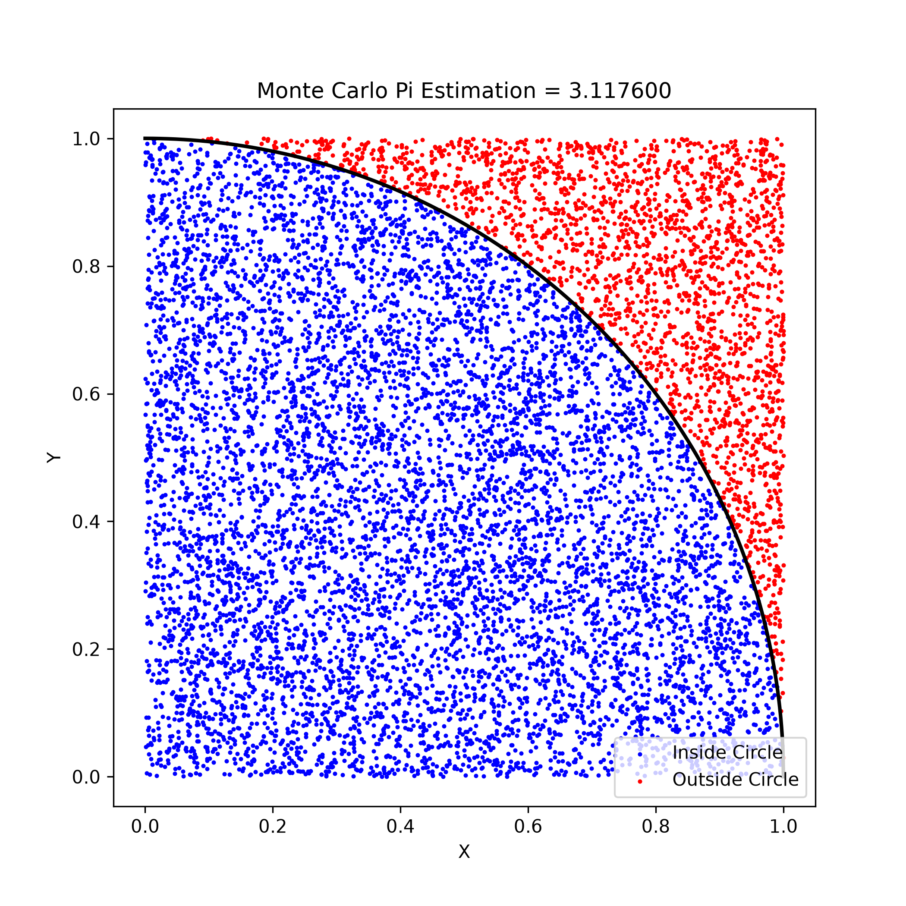
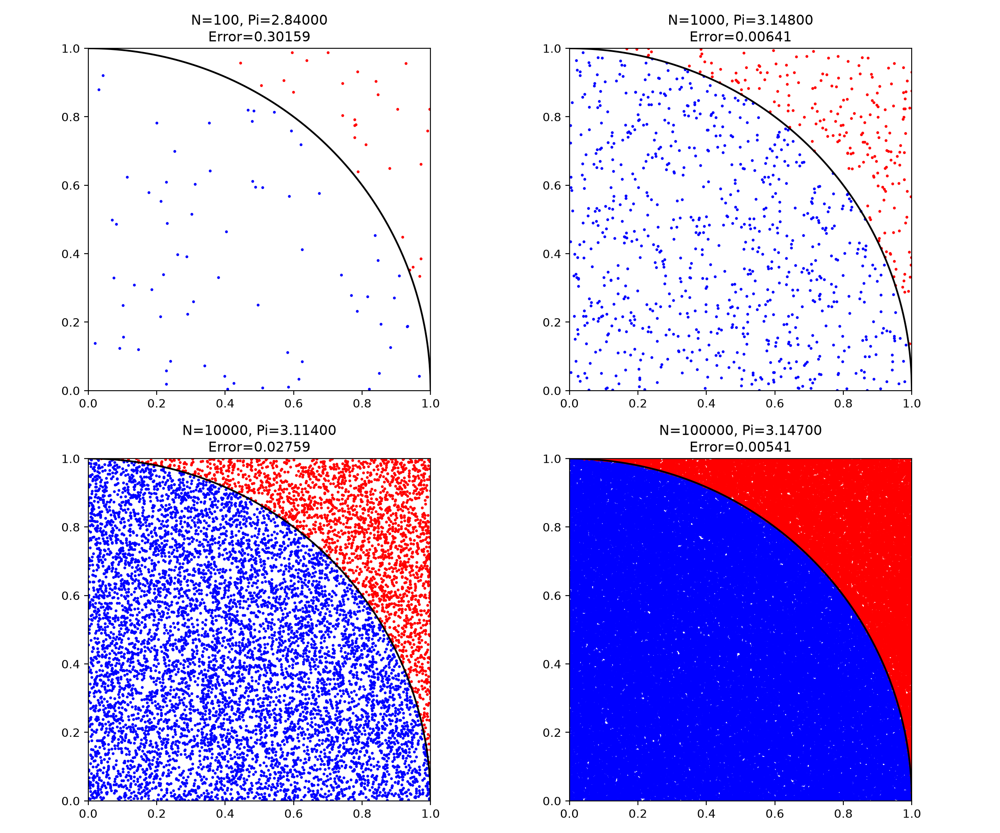

# 蒙特卡罗方法估算圆周率与图形可视化

## 一、项目简介

本项目是 Python 课程的蒙特卡罗方法实验，通过随机生成坐标点，利用统计方法估算圆周率 π，并使用 matplotlib 绘制随机撒点图形。

为了观察随机点数量对计算结果的影响，实验还分别使用 100、1000、10000 和 100000 个随机点进行对比。

## 二、实验原理

蒙特卡罗方法是一种利用随机抽样解决数学问题的方法。

本实验在边长为 1 的正方形内随机生成点，利用四分之一圆的面积与正方形面积之间的关系估算圆周率。

四分之一圆的半径为 1，面积为：

\[
S_{\text{圆}}=\frac{\pi}{4}
\]

正方形的面积为：

\[
S_{\text{正方形}}=1
\]

当生成的随机点足够多时，落在四分之一圆内部的点数比例会接近面积比例。

因此：

\[
\pi \approx 4\times\frac{\text{圆内点数}}{\text{随机点总数}}
\]

程序通过判断：

```python
x*x + y*y <= 1
```

确定随机点是否在四分之一圆内部。

## 三、开发环境

- 操作系统：Windows
- 编程语言：Python 3.14.2
- 开发工具：Visual Studio Code
- 绘图库：matplotlib 3.11.2
- 版本管理：Git、GitHub

安装依赖：

```bash
python -m pip install -r requirements.txt
```

## 四、项目文件说明

- `main.py`：实现蒙特卡罗圆周率估算和随机撒点可视化。
- `compare.py`：比较四种随机点数量的计算结果。
- `images/monte_carlo.png`：单次随机撒点实验图。
- `images/monte_carlo_comparison.png`：四组随机点对比图。
- `requirements.txt`：记录程序所需的 Python 第三方库。
- `README.md`：项目说明文档。

## 五、程序运行方法

### 1. 基础实验

在项目目录打开终端：

```bash
python main.py
```

程序会输出随机点数量、圆内点数、估算圆周率、实际圆周率和绝对误差，并生成随机撒点图。



### 2. 对比实验

执行：

```bash
python compare.py
```

程序分别使用四种不同数量的随机点估算圆周率，并生成对比图。



## 六、实验结果

本次运行得到以下结果：

| 随机点数量 | 估算圆周率 | 绝对误差 |
|---:|---:|---:|
| 100 | 2.840000 | 0.301593 |
| 1000 | 3.148000 | 0.006407 |
| 10000 | 3.114000 | 0.027593 |
| 100000 | 3.147000 | 0.005407 |

通过实验发现，随机点数量较少时，估算结果波动较大。增加随机点数量后，估算结果通常会更加稳定。

但由于蒙特卡罗方法具有随机性，单次实验的绝对误差并不一定随着点数增加而持续减小。例如，本次 10000 个随机点的误差就比 1000 个随机点更大。

## 七、实验收获

通过本次实验，我进一步理解了蒙特卡罗方法的基本思想，认识到可以利用随机抽样和统计比例来近似求解数学问题。

在编写程序的过程中，我练习了 Python 的循环、条件判断、列表和随机数生成等基础知识，还学习了使用 matplotlib 绘制散点图、设置坐标轴以及保存图片。

通过比较不同随机点数量的估算结果，我发现随机点越多，结果通常越稳定，但由于随机性的存在，单次实验不一定会更加准确。

这次作业让我认识到，除了直接使用数学公式计算结果，还可以通过编写程序和模拟实验来理解数学原理。

## 八、总结

本实验使用 Python 实现了基于蒙特卡罗方法的圆周率估算、随机撒点可视化，以及不同随机点数量的对比实验，达到了通过编程理解随机模拟方法的目的。